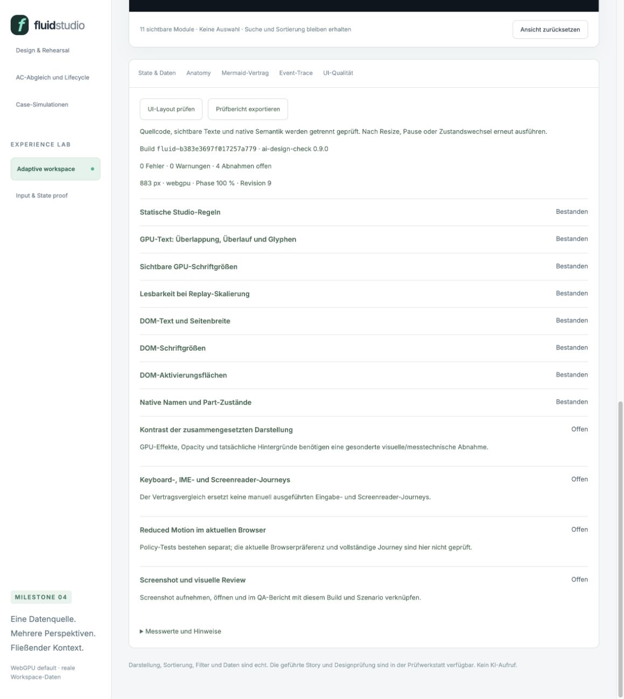
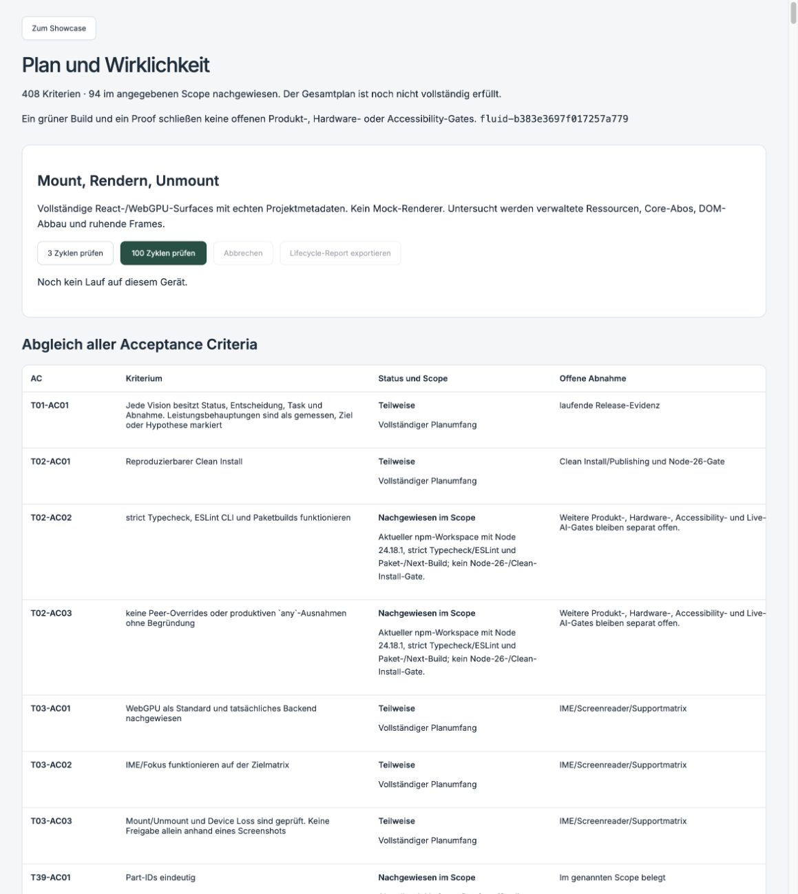
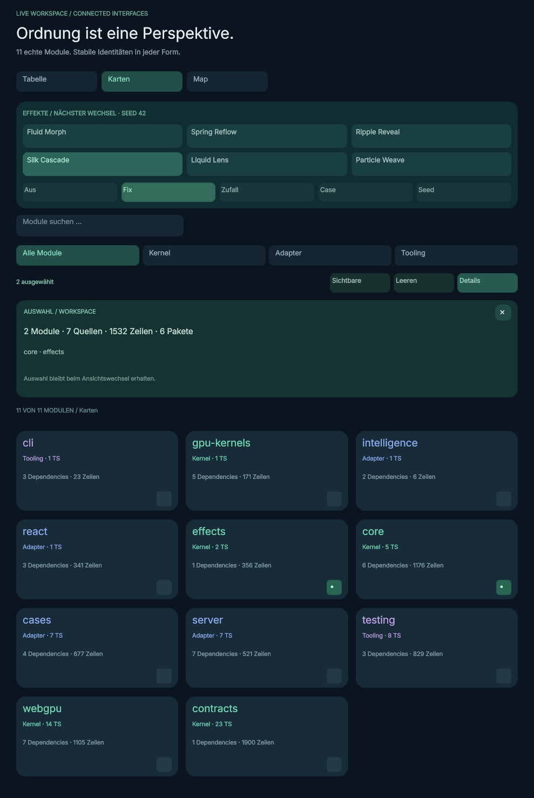
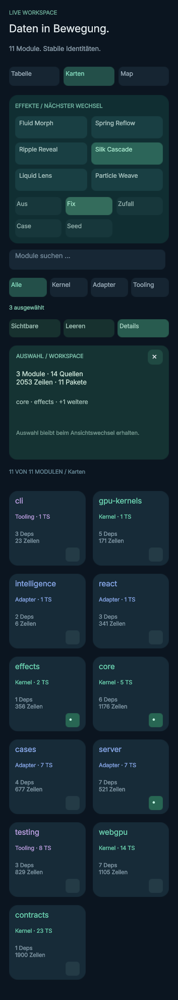

# UI-Layout prüfen

Im Showcase findest du „UI-Qualität“, in der Prüfwerkstatt „Layout & Semantik“.

1. Stelle den gewünschten Zustand her.
2. Warte auf das Ziel oder wähle am Animationsregler das Ende.
3. Wähle „UI-Layout prüfen“.
4. Lies Fehler, Warnungen und ausdrücklich offene Abnahmen.
5. Exportiere bei Bedarf den Prüfbericht.

Die Prüfer betrachten Quellregeln, sichtbaren DOM-Text, tatsächlich gezeichnete
GPU-Glyphen, Schriftgrößen und native Semantik getrennt. Ein fehlerfreier
Teilbereich bedeutet nicht, dass die gesamte Anwendung freigegeben ist.[^product]

## Meldungen richtig lesen

| Anzeige | Bedeutung |
|---|---|
| Bestanden | der benannte Prüfer hat im angegebenen Scope gemessen |
| Warnung oder Befund | konkrete Stelle und Grund untersuchen |
| Offen / nicht geprüft | dieser Nachweis fehlt noch |
| Größe geändert | Layout neu prüfen; ein älterer Bericht ist nicht mehr aktuell |
| Keine prüfbaren Texte | dieser Frame liefert keine Textabdeckung |

Während eines Übergangs können Texte vorübergehend fehlen. Ein solcher Frame ist
kein sauberer Text-Endpunkt. Prüfe Endzustände und Bewegung jeweils passend.
Nach Resize, Zustandswechsel oder anderer relevanter Präsentation neu messen.
Auch vollständig lesbarer Text genügt nicht, wenn Flächen oder Effekte fehlen:
Renderer- und Shaderfehler machen den betroffenen Lauf ungültig. Ein solcher
Fehler darf durch einen grünen Textprüfer nicht verdeckt werden. Die
[Sequenz- und Diagnoseansicht](rehearsal.md) verbindet deshalb Originalbilder,
Einzelprüfungen und die tatsächliche Zuordnung zu Effekt und Backend.

## Effekte gezielt nachprüfen

Unter **„M7-Abnahme“** (`/studio/m7`) prüfst du festgelegte
Ansichtswechsel oder frische Surfaces mit Ressourcen- und Schutzproben. Die
beiden Bereiche haben eigene Backendwahlen und Exporte. Ein grüner Matrixlauf
bedeutet nicht automatisch eine bestandene native Eingabe oder einen
Lifecycle-Lauf. [Die Bedienfolge](rehearsal.md) erklärt die getrennten Berichte.

## Laufzeitwerte fair beurteilen

Eine Performancezahl ist erst aussagekräftig, wenn die Messbedingungen bekannt
sind. Vorlauf, eigentlicher Test und Nachlauf müssen zusammen aufgezeichnet
werden. Gleichzeitig laufende CPU-/GPU-Aufgaben, Speicherdruck und der Aufwand
der Messwerkzeuge können das Ergebnis beeinflussen. Eigene Builds und Tests
laufen deshalb nicht neben einem vorgesehenen Benchmark.

Im Bericht sind das Framebudget und die Gültigkeit der Messumgebung getrennt.
„Belastet“ bezeichnet beobachtete Konkurrenz; „Unbestimmt“ bedeutet fehlende oder
nicht ausreichend zuordenbare Lastdaten. Das aktuelle GPU-Diagnosewerkzeug kann
keine vollständig isolierte GPU-/Tab-Last beweisen und liefert daher keine
umfassend gültige Benchmarkfreigabe. Auch wenig CPU-Last ändert das nicht.
Schwellen bleiben unverändert; ein schlechter Messwert wird weder gelöscht noch
nachträglich durch gelockerte Grenzwerte als bestanden dargestellt.

## Ein Problem melden

Notiere Ansicht, Bildschirmgröße, aktives Backend, genaue Schritte und erwartetes
Ergebnis. Füge den Prüfbericht und einen passenden Screenshot hinzu. Überlappende,
abgeschnittene oder doppelte Texte sollten reproduzierbar bezeichnet werden.

Der Bereich „AC-Abgleich und Lifecycle“ zeigt zusätzlich den umfassenderen
Abnahmestand; offene Punkte werden dort nicht durch einen grünen Screenshot gelöscht.

## Einen Bediennachweis speichern

Öffne im Showcase „UI-Qualität“ nach deiner Bedienung.

1. Pausiere den Übergang oder warte auf sein Ende. Kehre aus einem importierten
   Replay zuerst zur Live-Ansicht zurück.
2. Leere Suchtext oder private Eingaben bewusst. Enthält die Darstellung noch
   private Inhalte, wird die Aufnahme blockiert; Originalpixel werden nicht retuschiert.
3. Wähle **„Bediennachweis exportieren“**. Die Anzeige „Nachweis bereit“ bedeutet,
   dass Bild und Prüfbezüge im Browser vorbereitet sind. Sie bedeutet noch nicht,
   dass eine Datei gespeichert wurde.
4. Wähle **„JSON herunterladen“** und prüfe den tatsächlichen Browserdownload.
   „Download angefordert“ bestätigt die Anforderung, nicht den Speicherort.
5. Ändert sich vorher Auswahl, Fokus, Darstellung oder Größe, nimm den Nachweis
   erneut auf. Ein alter vorbereiteter Download wird ungültig.

Die lokale JSON-Datei enthält einen unveränderten Canvasframe, Zustand,
metadatenbeschränkten Trace und gemessene native Zielgeometrie mit gemeinsamem
Build-/Runbezug. Es gibt keinen Upload oder Modellaufruf. Der Export selbst
beweist keine echte Tastatur-/Pointereingabe; die beobachtete Bedienung gehört
als gesonderter Nachweis dazu. Ein Einzelbild ist keine Film- oder Leistungsprüfung.

Originale vom 13. November, Build `3cf71edcdbac59235548`: bei 1280 px Browserbreite
eine 989 × 1478 große Surface, bei 390 px eine 353 × 1980 große Surface. Auswahl
und Inspector stammen aus der jeweiligen echten Bedienfolge, nicht aus einer Illustration.

[^product]: Produktstand, tatsächliche Aufnahmerouten und Einschränkungen im Fakten-/Bildregister.
