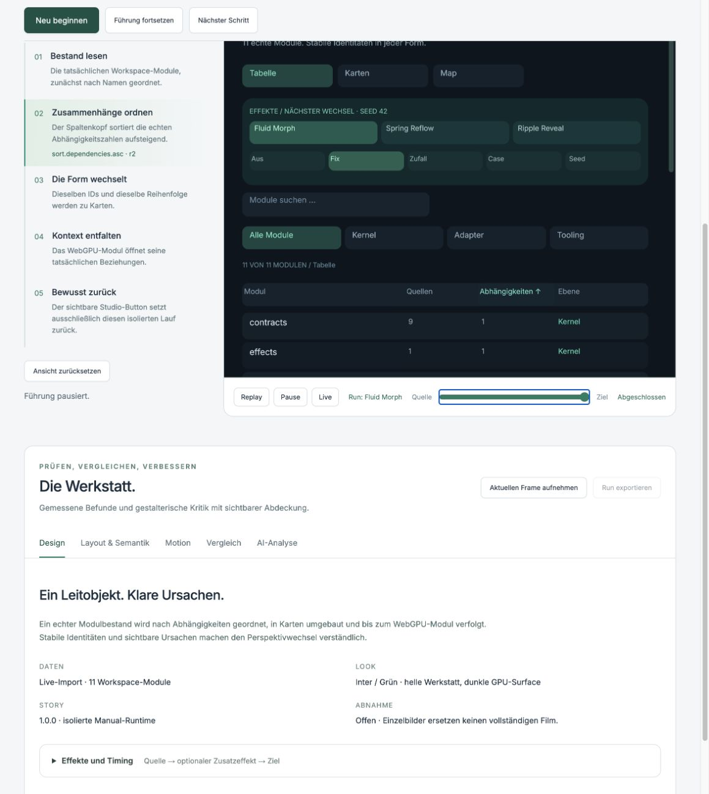
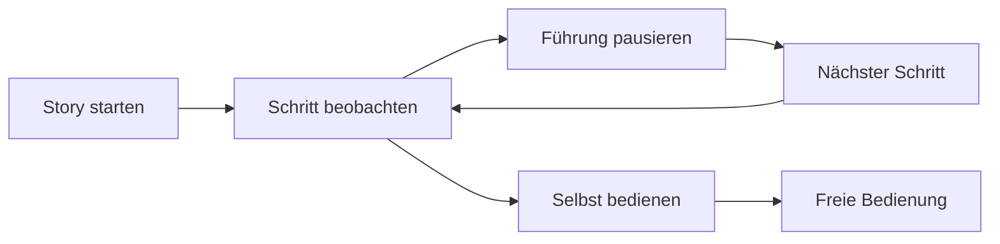
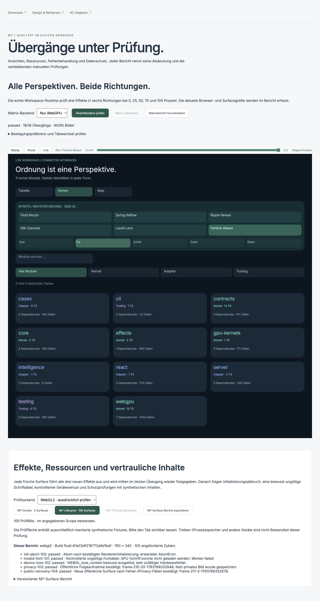

# Die Prüfwerkstatt öffnen

Wähle im Showcase „Design & Rehearsal“ oder „Story & Design prüfen“. Die Werkstatt
öffnet einen eigenen Arbeitslauf. Deine freie Workspace-Ansicht wird dadurch
nicht heimlich zurückgesetzt.[^product]

1. Warte auf „WebGPU aktiv“ oder den erklärten Fallback.
2. Wähle „Story starten“.
3. Beobachte die fünf beschriebenen Schritte.
4. Nutze „Führung pausieren“, um anzuhalten.
5. Wähle „Nächster Schritt“ für genau einen weiteren Schritt oder
   „Führung fortsetzen“ für die automatische Folge.

## Die fünf Schritte

Bestand lesen → Abhängigkeiten ordnen → Karten → WebGPU-Detail → bewusster Reset.
Die Inhalte bleiben dieselben. Die Schrittbeschreibung erklärt, wodurch ein Wechsel
ausgelöst wird. „Neu beginnen“ startet den Lauf erneut.

Wenn du selbst die GPU-Steuerung benutzt, übernimmst du die Bedienung. Die Führung
setzt ihre nächsten Schritte dann nicht im Hintergrund fort. Auch eine nicht
sichtbare oder in den Hintergrund geratene Führung kann pausieren. Die Führung
soll deinen Tastaturfokus nicht an sich ziehen.

## Unterschied zur neuen Effektvorführung

**„Neue Effekte erleben“** im Showcase zeigt Silk Cascade, Liquid Lens und Particle
Weave in einer eigenen Folge. Die hier beschriebene Prüfwerkstatt behält ihre fünf
Schritte. Du kannst beide Folgen unabhängig starten und stoppen. Die genaue
Bedienung der neuen Vorführung steht unter [Effekte wählen](effects.md).

## Entwürfe und Nachweise wiederfinden

Unter **Entwurf bearbeiten** kannst du einen Entwurf ausdrücklich als lokale Version speichern und später wieder laden. „Preflight“ prüft den Entwurf an den aktuellen Workspace-Daten. Erst die anschließende Übernahme ändert die aktive Ansicht. In „Design & Rehearsal“ nimmst du einen stabilen Live-Moment auf. Zu einem aufgenommenen Bild gehören Lauf, Zeitpunkt und Renderbackend. Unter „Abnahmekriterien“ lassen sich Nachweise nach ID und Status suchen und einzeln öffnen.[^product]

## Einen Übergang Bild für Bild prüfen

Im Motion-Bereich kannst du mit **„Sequenz prüfen“** die aktuelle Aufzeichnung
an festgelegten Zeitpunkten untersuchen. **„Prüfung abbrechen“** beendet den Lauf.
Mit **„Vorheriges Bild“** und **„Nächstes Bild“** siehst du die erfassten Phasen;
**„Sequenzbericht herunterladen“** sichert den Bericht mit Bild- und Prüfbezug.

Die Prüfung benötigt Zeit und ist auf kurze Übergänge und ein begrenztes
Bildbudget ausgelegt. Bediene die laufende Szene währenddessen nicht: Änderungen
können den Nachweis unvollständig machen. Vertrauliche Inhalte werden nicht
aufgenommen. Ein vollständiger Bericht bedeutet, dass alle vorgesehenen Bilder
vorliegen; Hinweise auf Text- oder Bewegungsfehler müssen trotzdem geprüft werden.
Die Geschwindigkeit dieser Bildaufnahme ist kein Maß für die normale Animation.

Für weitere Diagnosen gibt es **„Effekt-Stresstest · 100 Zyklen“** und
**„Retargeting prüfen · 100 Zyklen“** sowie **„Wiedergabe messen“**. Der Stresstest
wiederholt den Effekt und prüft seine verwalteten Ressourcen. Die Retargeting-
Prüfung unterbricht aufgezeichnete Übergänge an festgelegten Positionen und prüft,
ob die nächste Darstellung daran anschließt. Sie simuliert dabei keine echten
Maus- oder Tastatureingaben. Die Wiedergabemessung beobachtet den normalen Ablauf
ohne Bildaufnahme. **„Diagnoseberichte herunterladen“** sichert diese Ergebnisse.
Der Bericht nennt seinen Effekt, die Version, den aufgezeichneten Viewport und
das verwendete Backend. Er bleibt diesem Lauf zugeordnet, wenn du danach einen
anderen Effekt auswählst. Die Zeitmessung nennt neben typischen Intervallen auch
das längste Intervall und Werte über 50 ms, damit einzelne Ruckler sichtbar bleiben.
Ein bestandener Test gilt für den beschriebenen Lauf und das verwendete Gerät;
er ist keine allgemeine Freigabe aller Browser oder Eingabeverfahren.

## Die M7-Nachprüfung öffnen

Über **„M7-Abnahme“** in der Navigation öffnest du die zusätzliche Werkstatt
unter `/studio/m7`. Sie prüft die drei neuen Effekte mit
festgelegten Fällen. Sie trennt die echten Workspace-Ansichten von einer eigenen
Prüffläche für Ressourcen und vertrauliche Inhalte. Deine normalen Workspace-Daten
werden dafür nicht durch erfundene Angebote ersetzt; die isolierten Schutzproben
sind ausdrücklich synthetische Testinhalte.

Im Bereich **„Effekte, Ressourcen und vertrauliche Inhalte“** wählst du das
Prüfbackend. **„M7-Smoke · 3 Surfaces“** ist ein kurzer Vorcheck.
**„M7-Lifecycle · 100 Surfaces“** führt die ausführliche Ressourcenprüfung aus.
Lass den Tab sichtbar und nutze **„M7-Prüfung abbrechen“**, wenn du stoppen möchtest.
Mit **„M7-Surface-Bericht exportieren“** sicherst du das Ergebnis samt Build,
Backend, angeforderten Zyklen und erkannten Grenzen.

Die Aufnahme vom 4. November zeigt oben einen WebGPU-Matrixlauf und unten eine
separate WebGL2-Surfaceprüfung. Beide Backendwahlen und Ergebnisse gehören zu
ihrem jeweiligen Bereich; eine gemeinsame Seite macht daraus keinen gemeinsamen
Testlauf.

Die Workspace-Matrix untersucht Ansichtspaare und fünf Zeitpunkte eines Übergangs.
Wähle unter **„Matrix-Backend“** den Renderpfad und starte **„Ansichtsmatrix prüfen“**.
**„Matrix abbrechen“** stoppt den Lauf; **„Matrixbericht herunterladen“** sichert
den vorhandenen Bericht.
Ein Bericht gilt für die angezeigte Browsergröße und das tatsächlich verwendete
Backend. Er ersetzt keine anderen Größen, vollständige Filmaufnahme oder manuelle
Eingabeprüfung. „Nicht abschließend“ bedeutet, dass notwendige Beobachtungen fehlen;
es ist kein erfolgreicher Test mit weniger Fällen.

Unter **„Bewegungspräferenz und Tabwechsel prüfen“** kannst du die
**„Beobachtung starten“**, einen **„Umgebungs-Checkpoint“** setzen und nach deiner
Prüfung den **„Umgebungsbericht herunterladen“**. Dieser Bereich liest die vom
Browser gemeldeten Zustände; er ändert keine Systemeinstellung. Eine sichtbare
Präferenzanzeige allein beweist noch nicht, dass der laufende Übergang sie richtig
behandelt hat. Dafür gehören Zustand, Endbild und Bericht zusammen.

Die Story ist eine kontrollierte Bedienfolge auf echten Workspace-Daten. Sie ist
keine Vorhersage durch ein Modell. Im nächsten Kapitel kannst du
[Frames aufnehmen und vergleichen](comparison.md).

[^product]: Produktstand, tatsächliche Aufnahmerouten und Einschränkungen im Fakten-/Bildregister.
