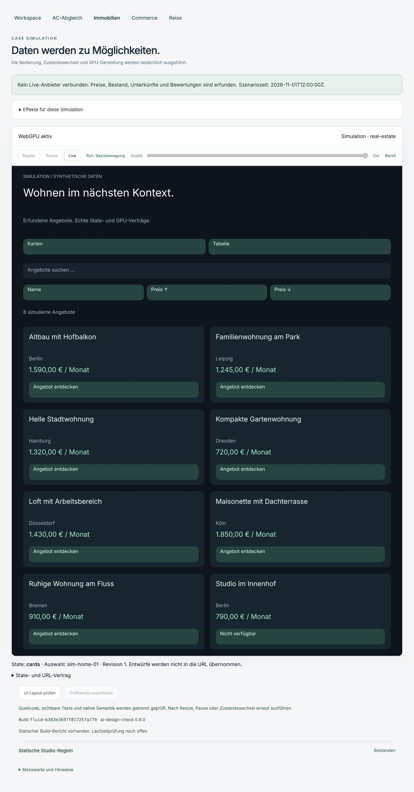
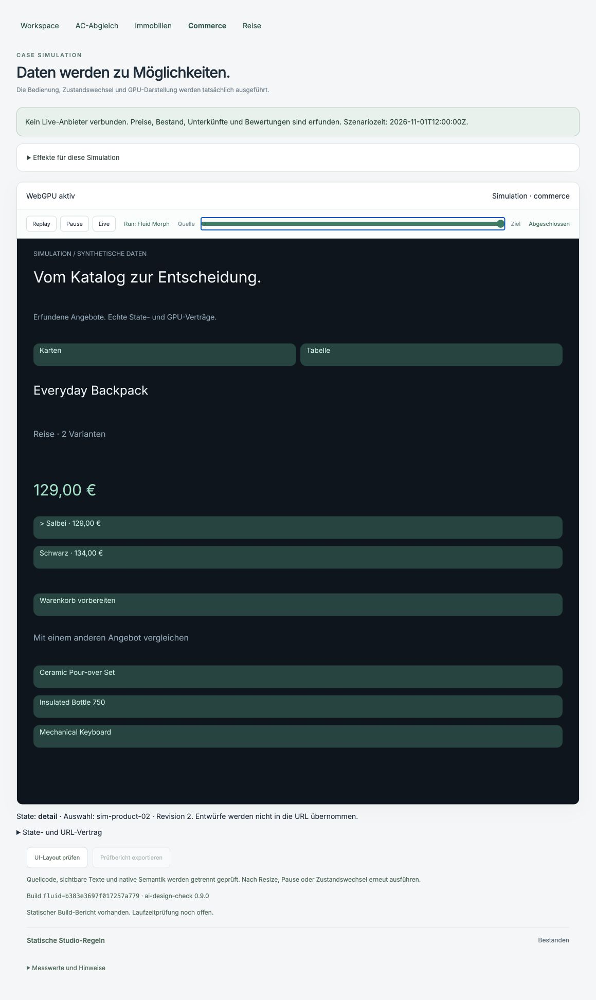
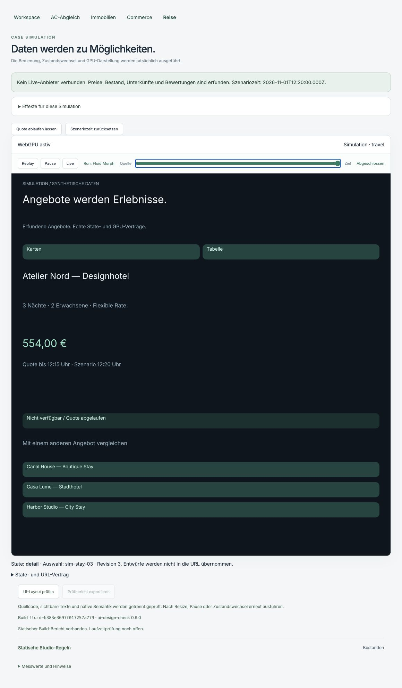
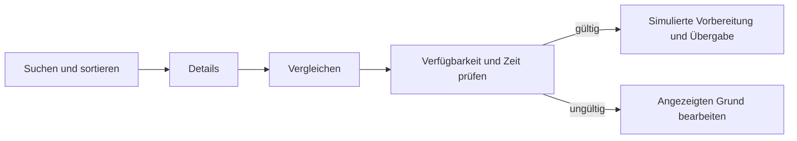

# Drei Praxisfälle

Öffne „Case-Simulationen“ und wähle Immobilien, Commerce oder Reise. Alle Angebote,
Preise, Bestände, Unterkünfte und Bewertungen in diesen Bereichen sind erfunden.
Die Bedienung, Zustandswechsel und GPU-Darstellung werden tatsächlich ausgeführt.[^product]

## Ein Angebot vergleichen

1. Suche nach einem passenden Begriff oder wechsle die Sortierung.
2. Öffne „Angebot entdecken“ bei einem Angebot.
3. Wähle einen angebotenen Vergleichspartner.
4. Lies die beiden angebotenen Datensätze.
5. Kehre über Karten oder Tabelle zur Übersicht zurück.

Im Commerce-Fall können Varianten und Bestand die Vorbereitung begrenzen. Bei
Immobilien hängt sie unter anderem von der Verfügbarkeit des ausgewählten
Datensatzes ab. Ein deaktivierter oder abgewiesener Vorgang bedeutet nicht, dass
die Daten verschwunden sind.

## Reise und ablaufende Quotes

Wähle im Reisefall „Quote ablaufen lassen“, um eine abgelaufene Szenariozeit zu
simulieren. Vorbereitung beziehungsweise Übergabe darf danach nicht einfach
fortfahren. „Szenariozeit zurücksetzen“ stellt die definierte Ausgangszeit wieder her.
Es handelt sich um eine kontrollierte Szenariozeit, nicht um ein live aktualisiertes
Anbieterangebot.

**Es wird nichts gekauft, gebucht oder versendet.** „Vorbereitet“ und „Übergabe“
sind Simulationsergebnisse. Für echte Vorgänge muss ein Betreiber einen geprüften
Anbieter- und Transaktionsadapter bereitstellen. Entwürfe gehören nicht in die URL.

[^product]: Produktstand, tatsächliche Aufnahmerouten und Einschränkungen im Fakten-/Bildregister.
