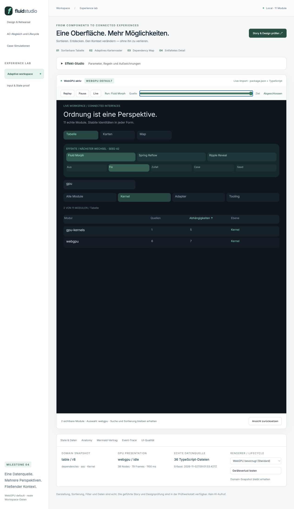

# Sortieren

**Voraussetzung:** Die GPU-Oberfläche ist bereit. Öffne bei Bedarf „Tabelle“.

1. Aktiviere den Kopf „Modul“, „Quellen“ oder „Abhängigkeiten“.
2. Der Pfeil zeigt die aktuelle Richtung an.
3. Aktiviere denselben Kopf nochmals, um die Richtung umzukehren.

Zahlen werden numerisch sortiert. Bei gleichen Werten bleibt die Reihenfolge
anhand der Modulkennungen stabil. Die gewählte Sortierung gilt auch dann weiter,
wenn du zu Karten oder Map wechselst.[^product]

## Suche und Ebene kombinieren

1. Gib einen Begriff in „Module suchen“ ein, zum Beispiel `gpu`.
2. Wähle optional Kernel, Adapter oder Tooling.
3. Prüfe die angezeigte Trefferzahl.
4. Leere das Suchfeld oder wähle „Alle Module“, um wieder mehr zu sehen.

**Erwartetes Ergebnis:** Sichtbar sind nur Module, die beide Bedingungen erfüllen.
Suche löscht keine Daten und löst keinen AI-Aufruf aus.

## Auswahl beim Sortieren und Filtern

Markierte Module behalten ihre Kennung, wenn sich die Reihenfolge ändert.
Die Tastatur-Bereichsauswahl folgt der gerade sichtbaren sortierten Liste.
„Sichtbare“ in der Auswahlleiste bezieht sich auf den aktuellen Filter;
„Leeren“ entfernt die Mehrfachauswahl. Ausgeblendete markierte Module werden
im Auswahlzähler gesondert genannt und im Kontextbereich berücksichtigt.

Schreibst du im Suchfeld, bleiben Buchstaben und Ctrl/Meta+A normale
Texteingaben beziehungsweise Textauswahl. Die Collection-Kürzel greifen dort
nicht. Außerhalb des Suchfelds kann die [Tastaturbedienung](accessibility.md)
gezielt durch die Modul-Auswahlmarkierungen navigieren.

## Wenn keine Treffer erscheinen

Prüfe Schreibweise und Ebene. Nutze „Filter zurücksetzen“ im leeren Ergebnis oder
„Ansicht zurücksetzen“. Der Suchbegriff bleibt lokal und wird nicht in die URL
übernommen. Ein geteilter Link stellt deshalb nicht automatisch dein Suchfeld wieder her.

Mit Tab erreichst du Suchfeld, Filter und Sortierköpfe; Enter beziehungsweise
Leertaste aktiviert fokussierte Schalter. Details zur Eingabe stehen unter
[Bedienhilfen](accessibility.md).

[^product]: Produktstand, tatsächliche Aufnahmerouten und Einschränkungen im Fakten-/Bildregister.
