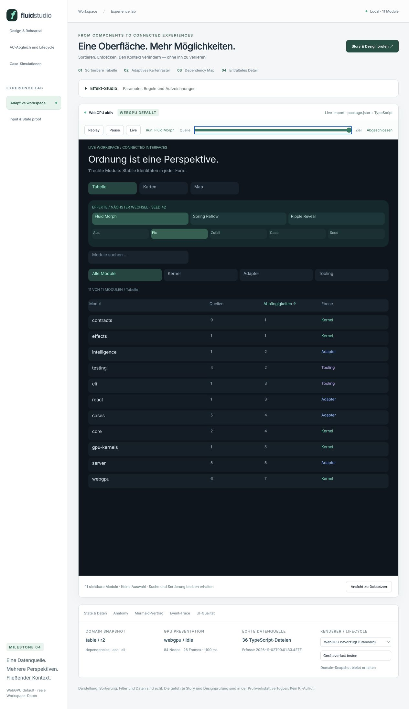
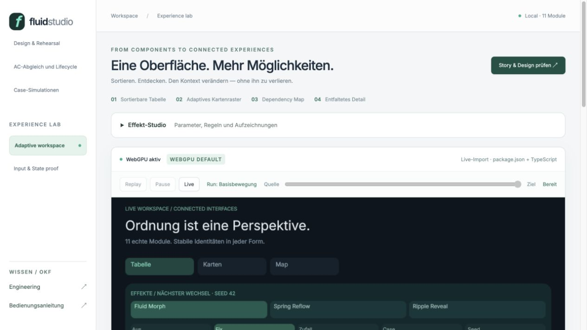

# Willkommen in Fluid Studio

Fluid Studio zeigt, wie eine Oberfläche ihre Form wechseln kann und dabei denselben
Inhalt behält. Du kannst echte Workspace-Module sortieren, suchen und als Tabelle,
Karten oder Map betrachten. In der Prüfwerkstatt lassen sich die Wechsel gezielt
vorführen und untersuchen.[^product]

## Wofür die Ansichtswechsel gut sind

In einer Tabelle vergleichst du Werte, auf Karten erkennst du Inhalte und in der
Map untersuchst du Beziehungen. Deine Auswahl bleibt beim Wechsel erhalten.
So kannst du einen Bestand aus mehreren Perspektiven betrachten, ohne ihn jedes
Mal neu zusammenzustellen. Eine passende Bewegung zeigt, wo ein Objekt wieder
auftaucht. Zusätzliche Effekte kannst du abschalten; für die Aufgabe ist kein
besonders auffälliger Übergang erforderlich.

Probiere es mit einem ausgewählten Modul aus: sortieren, Karten öffnen, Map
ansehen und ins Detail wechseln. Achte darauf, ob du deine Auswahl wiederfindest.
Das ist das Gestaltungsziel dieser Alpha; eine allgemeine Verbesserung aller
Arbeitsabläufe ist damit noch nicht nachgewiesen.

Die vollständige Einordnung steht in [Warum Fluid UI?](why-fluid.md): Nutzen,
Usability, Grafiktechnik, Zukunftsperspektive und bewusste Grenzen.

## Sprache während der Arbeit wechseln

Links im Menü **Sprache** stehen Deutsch, English und Français zur Wahl. Auf einem schmalen Bildschirm öffnest du zuerst die Navigation. Wähle zwei Module, wechsle zur Vergleichsansicht und schalte mitten in der Bewegung auf Französisch um. Auswahl, Datenwerte und Sortierung bleiben erhalten. Ein geteilter Link behält seine Sprache. In einer angefangenen Texteingabe wartet der Wechsel bis zum Ende der Zeichenkomposition. Die beiden Handbuchlinks öffnen die passende Ausgabe. Im Handbuch kannst du beim Sprachwechsel dasselbe Kapitel weiterlesen.

## Öffnen

Öffne die bereitgestellte Studio-Adresse. Bei der lokalen Alpha ist das
[Fluid Studio](http://127.0.0.1:3010/). Wenn du das Projekt selbst startest:

```sh
npm ci
npm run dev -w @fluidkit/studio -- --port 3010
```

Dafür brauchst du die Projektdateien und die unterstützte Node-Umgebung. Ein
OpenAI-Key ist für die normale Bedienung nicht erforderlich.

## Die wichtigsten Bereiche

| Bereich | Wofür du ihn verwendest |
|---|---|
| Modulwerkstatt | Module sortieren, als Karten anordnen, Gruppen öffnen und Auswahl vergleichen |
| Formübergänge | Dieselbe Auswahl mit beiden Bewegungsvarianten prüfen |
| Entwurf bearbeiten | Manuellen oder unterstützten Entwurf prüfen, als lokale Version speichern und laden |
| Effekt-Studio | Form und Timing des nächsten Wechsels einstellen |
| Design & Rehearsal | eine geführte Story abspielen, Bilder aufnehmen und prüfen |
| M7-Abnahme (`/studio/m7`) | feste Ansichtswechsel und Ressourcen-/Schutzprüfungen ausführen |
| AC-Abgleich und Lifecycle | Abnahmestand und technische Nachweise ansehen |
| Case-Simulationen | Immobilien-, Commerce- und Reiseabläufe ausprobieren |
| Input & State proof | grundlegende Eingabe- und Zustandsregeln nachvollziehen |



Warte, bis oberhalb der Zeichenfläche „WebGPU aktiv“ oder ein ausdrücklich
gekennzeichneter WebGL2-Fallback erscheint. „GPU nicht bereit“ ist noch kein
bedienbarer Endzustand. Bei einer Diagnose hilft [Fehler beheben](troubleshooting.md).

Die aktuelle Ausgabe ist eine Alpha. [Version und Grenzen](version-status.md)
erklärt, was bereits funktioniert. Beginne für eine kurze Tour mit
[Workspace verstehen](workspace.md), danach [Sortieren und suchen](sorting-search.md).

## Knowledge im Studio öffnen

Auf großen Bildschirmen findest du unten links unter „Wissen“ die Links
„Engineering“ und „Bedienungsanleitung“. Beide öffnen ein eigenes Tab. Deine
aktuelle Arbeitsfläche bleibt geöffnet. Auf schmalen Bildschirmen öffnest du zuerst „Navigation“. Die Handbücher werden direkt über die
Studio-Adresse ausgeliefert; separate Vorschau-Server sind dafür nicht nötig.



[^product]: Produktstand, tatsächliche Aufnahmerouten und Einschränkungen im Fakten-/Bildregister.
