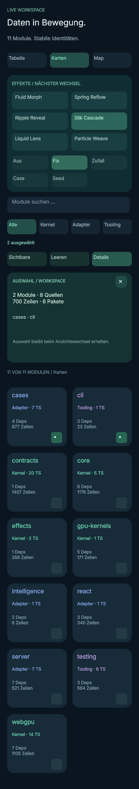
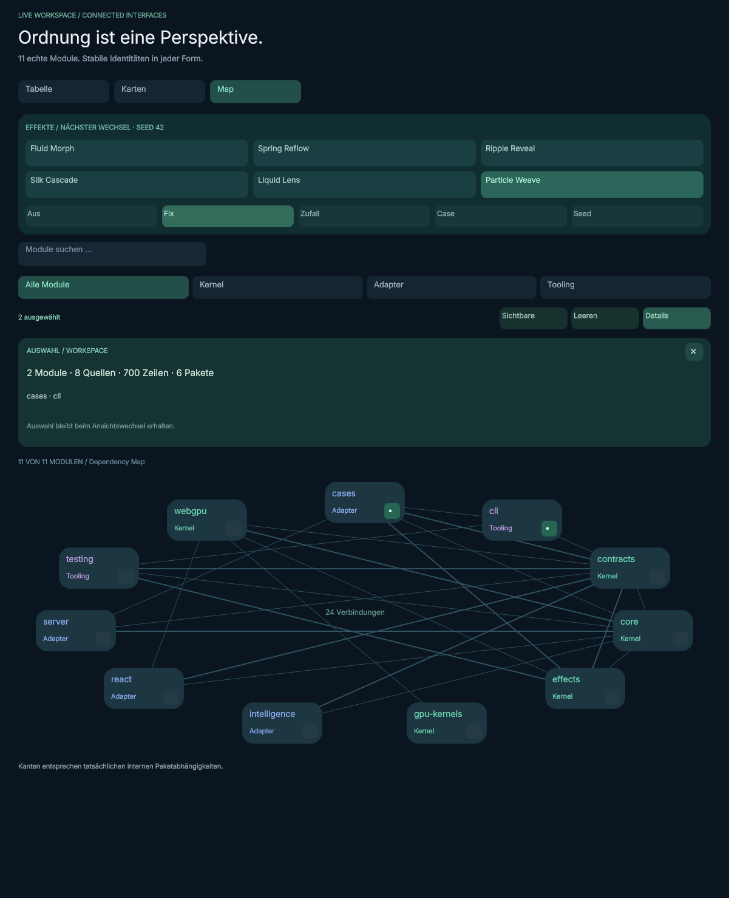
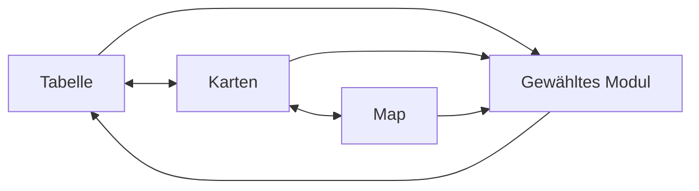

# Die Perspektive wechseln

| Ansicht | Besonders geeignet für |
|---|---|
| Tabelle | Zahlen vergleichen und sortieren |
| Karten | Module als übersichtliche Einheiten betrachten |
| Map | interne Paketbeziehungen entdecken |
| Detail | ein bestimmtes Modul und seine Paketliste lesen |
| Vergleich | zwei bis vier gewählte Module anhand echter Kennzahlen vergleichen |
| Atlas | Größenverhältnisse nach Dateien oder Codezeilen erkunden |

Aktiviere „Tabelle“, „Karten“, „Map“, „Vergleich“ oder „Atlas“ in der Zeichenfläche. Der Inhalt wird
fließend umgeordnet. Die Daten sind schon beim gültigen Wechsel bestätigt; die
Animation zeigt den Übergang. Du musst nicht warten, bis eine Animation endet,
um eine neue zulässige Aktion auszulösen.[^product]

Unveränderte originale M8-Kontrollpunkte vom 13. November, Build
`dfc8a56ebe0e58ace2ea`. Die schmale Aufnahme stammt aus einem 390-px-Browser
mit tatsächlich 351-px-breiter Zeichenfläche.

Die neuen Cases erklärt [Perspektiven erkunden](perspectives.md).
[Farbwelt wählen](appearance.md) beschreibt die acht Paletten und eigene Akzente.
Die grünen M8-Bilder unten dokumentieren den früheren Build; die aktuelle
Oberfläche startet mit Blau.

## Detail öffnen und zurückkehren

Aktiviere das gewünschte Modul. Seine stabile Kennung bestimmt die Detailansicht.
Die fünf Ansichtsschalter bleiben erreichbar und führen wieder in die entsprechende
Übersicht. Die aktuelle Alpha markiert dabei noch nicht durchgehend eine
Herkunftsansicht; eine explizitere Rückwegdarstellung ist als Verbesserung erfasst.

Sortierung, Ebene, Moduldetail und Mehrfachauswahl können im Link mitgeführt
werden. Für die Mehrfachauswahl enthält der Link mehrere `picked`-Einträge.
Das Markieren eines Moduls aktualisiert den aktuellen Verlaufseintrag; es
produziert keinen eigenen Zurück-Schritt. Ansicht, Sortierung und Ebene erzeugen
weiterhin Navigationsschritte. Browser-Zurück und -Vorwärts stellen die im
jeweiligen Eintrag gespeicherten Felder wieder her.

Suchtext, Tastaturfokus, offener Kontextbereich und Animationsposition bleiben
lokal. Ein Reload startet keine externe Transaktion. Die M8-Erweiterung ist lokal im jeweils dokumentierten Scope geprüft;
allgemeine Produktionsgates bleiben offen. Bilder behalten ihren konkreten Buildbezug.

## Zwei Bedienbibliotheken vergleichen

Unter `/studio/behaviors` öffnet „UI SDK“ beziehungsweise „Base UI“ eine andere
DOM-Steuerung für dieselbe GPU-Vorschau. Wähle eine Ansicht und Ebene, wechsle
dann die Bibliothek und kontrolliere, dass die Werte erhalten bleiben.
„Kontext prüfen“ öffnet einen Dialog mit den aktuellen Daten. Escape schließt
ihn und führt zum Auslöser zurück. Dieser Dialog gehört zum Vergleich; der
„Details“-Bereich der GPU-Auswahl bleibt nichtmodal.

Die Backendanzeige nennt das tatsächlich verwendete WebGPU oder WebGL2. Die
Interaktionsliste zeigt einzelne Requests und Revisionen; sie ist kein
Qualitätssiegel oder automatisch bestimmter Gewinner. Die Vergleichsroute
führt keine AI-Anfrage aus. Der deaktivierte „Detail“-Tab kann bei beiden
Bibliotheken per Tastatur fokussiert werden; er öffnet ohne ausgewähltes Modul
keine Ansicht. Fokus bedeutet hier nicht Aktivierung.

Im lokalen Vergleich funktionieren Tastaturwahl, Dialog und Rückkehr auf beiden
Pfaden. Fluid verwendet Base UI weiterhin für diese Studio-Bausteine; UI SDK
bleibt als auswählbarer Vergleich verfügbar. Das ist keine Behauptung, eine
Bibliothek sei allgemein zugänglicher oder qualitativ überlegen.

## Einen Workspace neu zusammenstellen

Öffne `/studio/authoring`. Die Arbeitsfläche verwendet deinen tatsächlichen
Modulbestand. Du kannst Kennzahlen, Modul-Explorer und Projektnotiz anordnen,
eine Startansicht und einen Akzent wählen. Die erlaubten Akzente heißen
`forest`, `indigo` und `amber`; der Modul-Explorer bleibt erforderlich.
`forest` ist ein gespeicherter Vertragsname für den Standardstil; seine
Darstellung folgt jetzt der globalen Farbwelt. Bestehende Dokumente werden
deshalb nicht umgeschrieben.

1. Bearbeite den Titel oder „Dokument · registrierte Bausteine“. Die gezeichnete
   aktive Arbeitsfläche bleibt dabei erhalten.
2. Optional: Beschreibe die gewünschte Änderung und wähle „AI-Entwurf erstellen“.
   „Abbrechen“ beendet die Generierung. Die Zwischenanzeige „noch nicht gültig“
   ist kein angewandtes Ergebnis.
3. Wähle „Entwurf prüfen“. Lies die Befunde und „Änderungsdiff ansehen“.
4. Wähle nach bestandenem Preflight „Entwurf visuell ansehen“. Die Anzeige
   „Isolierter Entwurf · noch nicht übernommen“ kennzeichnet die eigene
   Vorschau. „Aktiven Workspace ansehen“ wechselt zum bisherigen Stand zurück.
   Ausprobierte Auswahl- oder Eingabeänderungen in der Vorschau verändern den
   aktiven Workspace nicht und werden bei der Übernahme nicht mitkopiert.
5. Übernimm einen gültigen Entwurf ausdrücklich oder verwirf ihn. Hat sich der
   Workspace inzwischen verändert, prüfe erneut.
6. „Diff herunterladen“ speichert einen prüfbaren Änderungsvorschlag; es ändert
   keine Projektdateien und veröffentlicht nichts.

Auswahl, Suche und Notiz werden beim zulässigen Wechsel übernommen. Eine
gefüllte Notiz darf nicht durch Entfernen ihres Bausteins verschwinden. Eine
laufende Eingabe muss vor der Übernahme abgeschlossen sein. Die Notiz bleibt
in dieser Sitzung; die Oberfläche ist noch kein dauerhaftes Projektarchiv.

Für AI gehen dein Auftrag, das bisherige Layoutdokument, der Bausteinkatalog und
drei Kennzahlen an OpenAI. Notiz, Auswahl und Suchtext werden nicht automatisch
mitgesendet. Die manuelle Dokumentgestaltung benötigt keinen Modellanbieter.
Der Ablauf wurde am 13. November lokal mit OpenAI und WebGPU ausgeführt:
Entwurf, Preflight, getrennte Vorschau und ausdrückliche Übernahme funktionierten;
Auswahl und Notiz blieben erhalten. Alle M8-Kriterien sind im begrenzten lokalen Scope belegt; breitere
Geräte-/Accessibility-Prüfungen und Produktionsgates sind weiterhin offen.

[^product]: Produktstand, tatsächliche Aufnahmerouten und Einschränkungen im Fakten-/Bildregister.
