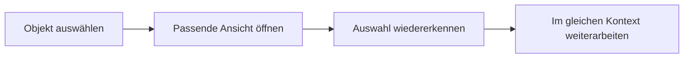
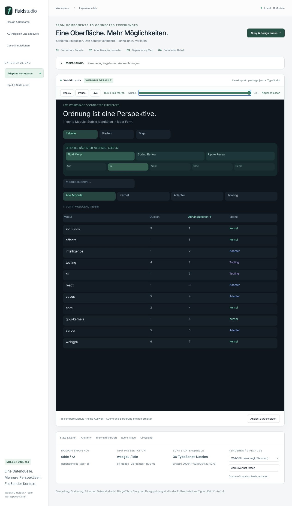

# Warum Fluid UI?

**Eine Oberfläche kann ihre Perspektive wechseln und dabei deinen Arbeitskontext
behalten.** In der Tabelle vergleichst du Werte, auf Karten erkennst du Inhalte,
in der Map untersuchst du Beziehungen und im Detail arbeitest du weiter. Es sind
Ansichten desselben Bestands. Deine Auswahl verbindet sie.

## Welche Usability-Vorteile das bringen kann

| Nutzen | Was du davon merkst |
|---|---|
| Orientierung behalten | Ein ausgewähltes Objekt bleibt beim Sortieren oder Ansichtswechsel wiedererkennbar. Du kannst verfolgen, wo es wieder auftaucht. |
| Änderungen verstehen | Ein passender Übergang zeigt, was sich durch deine Aktion verändert hat und welche Elemente zusammengehören. |
| Komplexität passend entfalten | Du beginnst mit einer Übersicht und öffnest weitere Informationen bei Bedarf. Häufige Aufgaben sollen direkt erreichbar bleiben. |
| Aufgabengerecht arbeiten | Du wählst die Ansicht, die zu deinem nächsten Schritt passt. Filter und Auswahl müssen dafür nicht immer neu aufgebaut werden. |
| Vertraute Gestaltung erleben | Wiederkehrende Formen und Bewegungen können dem Produkt eine eigene, konsistente Sprache geben. |

Die Grundlagen heißen unter anderem
[Objektkontinuität](https://bost.ocks.org/mike/constancy/) und
[Progressive Disclosure](https://www.nngroup.com/articles/progressive-disclosure/).
[Kontrollierte Studien zu Datenvisualisierungen](https://idl.uw.edu/papers/animated-transitions)
zeigen Vorteile sinnvoll gestalteter Übergänge in den untersuchten Aufgaben.
FluidKit nutzt diese Prinzipien als Gestaltungsgrundlage. Ob deine Arbeit dadurch
schneller oder fehlerärmer wird, muss an konkreten Aufgaben geprüft werden.

## Eine kurze Übung

1. Wähle im Workspace ein Modul in der Tabelle aus.
2. Ändere die Sortierung und suche deine Auswahl wieder.
3. Öffne Karten und anschließend die Map. Prüfe, ob du dasselbe Modul erkennst.
4. Öffne das Detail und kehre zur Übersicht zurück.

**Erwartung:** Datenidentität und Auswahl verbinden die Ansichten. Eine zusätzliche
Bewegung ist optional. Stelle den Effekt auf „Aus“ oder nutze reduzierte Bewegung,
wenn dir das beim Arbeiten hilft. [Ansichten](views.md), [Sortieren](sorting-search.md)
und [Effekte](effects.md) erklären die konkreten Bedienelemente.

## Warum dafür GPU-Grafik?

Eine gemeinsame Grafikszene gibt den Entwicklern Spielraum für zusammenhängende
Übergänge, weiche Formen, Masken, Tiefe und besondere Materialien. So können
Bedienelemente, Datenansichten und interaktive Grafiken eine gemeinsame visuelle
Erfahrung bilden. Three.js liefert Bausteine dafür; WebGPU eröffnet außerdem
parallele Berechnungen, etwa für spätere Simulationen.
[WebGPU](https://www.w3.org/TR/webgpu/),
[Three.js](https://threejs.org/manual/pages/webgpurenderer).

Auch normale Webseiten können flüssig animieren. Grafiktechnik allein garantiert
keine bessere Bedienung oder höhere Geschwindigkeit. Für dich zählen eine
verständliche Aufgabe, lesbare Inhalte, direkte Reaktion und Kontrolle über die
Darstellung. [Qualität](quality.md) erklärt, wie diese Aspekte geprüft werden.

## Browser und Zukunft

WebGPU wird inzwischen in Chrome/Edge, Safari und Firefox ausgeliefert.
Betriebssystem, GPU und Treiber bestimmen mit, welche Kombination tatsächlich
funktioniert. Das Studio zeigt deshalb oberhalb der Arbeitsfläche „WebGPU aktiv“
oder einen ausdrücklich gekennzeichneten WebGL2-Fallback an.
[Offizieller Plattformstand, recherchiert am 2. November 2026](https://github.com/gpuweb/gpuweb/wiki/Implementation-Status).

Mit wachsender Geräteabdeckung und leistungsfähigeren GPUs können zusätzliche
Darstellungen und Berechnungen sinnvoll werden. Lokale AI-Modelle sind eine weitere
Perspektive: [ONNX Runtime Web](https://onnxruntime.ai/docs/tutorials/web/ep-webgpu.html)
unterstützt WebGPU bereits. Im aktuellen Studio werden freigegebene Analysebilder
jedoch an den angegebenen Cloudanbieter gesendet. Eine lokale Modelloption ist
kein bereits verfügbares Bedienfeature.

Assistenz kann künftig eine geeignete Ansicht vorschlagen. Nutzerkontrolle,
aktive Eingaben und nachvollziehbare Änderungen bleiben dabei Gestaltungsziele.
Die Alpha besitzt noch keine vollständige produktive Intent-Pipeline.
[Version und Grenzen](version-status.md) trennt Gegenwart und Roadmap.

## Bleiben Inhalte vor Kopieren geschützt?

**WebGPU ist kein Kopierschutz.** Eine reine Pixelansicht gibt einfachen
DOM-Scrapern weniger direkt kopierbares Darstellungs-Markup. Das schützt aber
keine bereits ausgelieferten Daten: Bilder können aufgenommen, Texte per
[OCR](https://docs.cloud.google.com/vision/docs/ocr) gelesen und
[Netzwerkantworten](https://developer.chrome.com/docs/devtools/network/) untersucht werden.
Eine messbare Schutzwirkung für FluidKit wurde nicht nachgewiesen.

Die Anwendung erschließt Rollen, Labels und Werte absichtlich für assistive
Werkzeuge. Diese Zugänglichkeit soll erhalten bleiben. Zugriffsschutz und die
bewusste Freigabe von Daten sind eigene Aufgaben. Die
[Datenschutzhinweise](privacy.md) erklären insbesondere die AI-Bildfreigabe.

## Bewusste Grenzen

| Thema | Was berücksichtigt wird |
|---|---|
| Accessibility | Tastatur, Fokus, Screenreader, Texteingabe und Zoom benötigen eigene Prüfungen. [Bedienhilfen](accessibility.md) erklärt vorhandene Möglichkeiten und offene Abnahmen. |
| Bewegung | Zusatzeffekte sind optional. Reduzierte Bewegung hilft, wenn Animation ablenkt oder unangenehm ist. |
| Leistung und Akku | Anspruchsvolle Effekte brauchen Gerätebudgets; mehr GPU-Leistung macht sparsame Darstellung weiterhin sinnvoll. Eine pauschale Überlegenheit wird nicht versprochen. |
| Auffindbarkeit im Web | Öffentliche Inhalte brauchen lesbares HTML und echte Links. Die interaktive GPU-Arbeitsfläche kann diese Veröffentlichung ergänzen. |
| Reifegrad | Die Alpha zeigt einen konkreten Ausschnitt. Weitere Widgets, Geräte und Abläufe werden gesondert qualifiziert. |

Der Sinn von Fluid UI ist eine passende, zusammenhängende Arbeitsoberfläche.
Die Effekte helfen dann, wenn sie Orientierung und Verständnis unterstützen.
