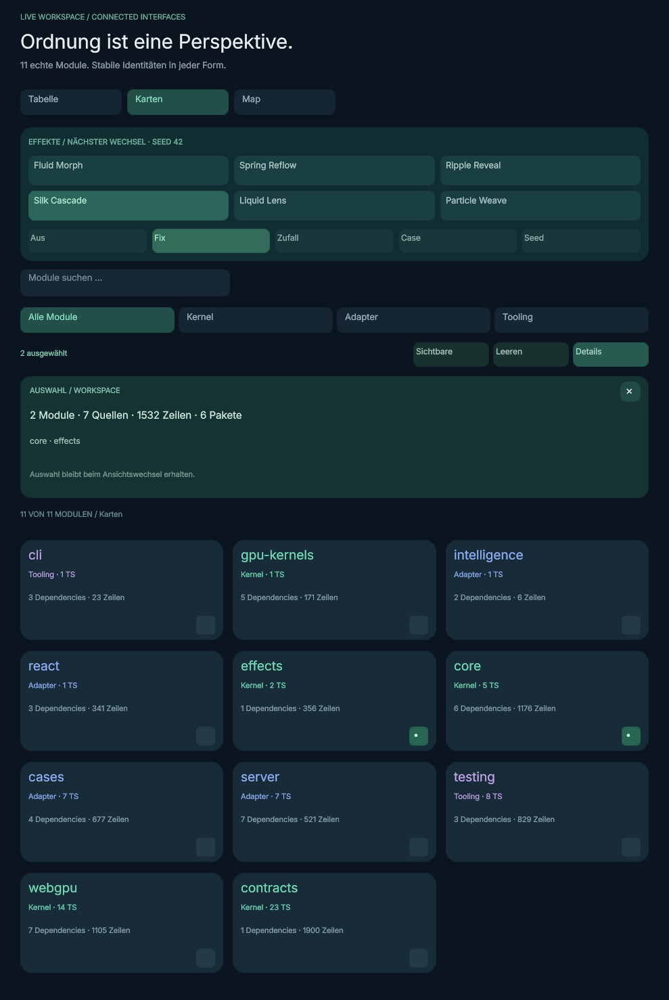
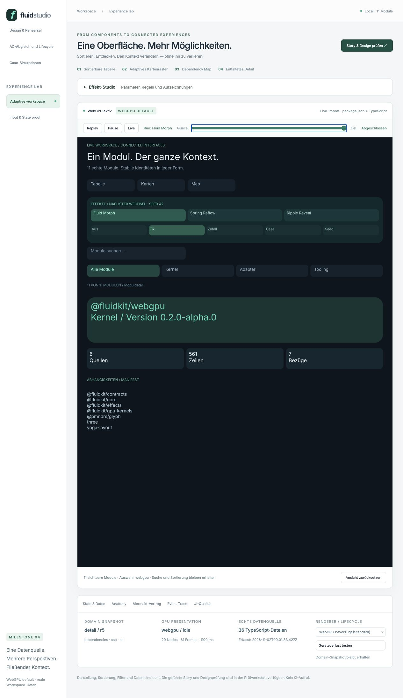

# Ein Bestand, mehrere Perspektiven

Der Workspace liest tatsächlich vorhandene Projektmodule. Jede Zeile oder Karte
steht für dasselbe Modul, unabhängig von ihrer aktuellen Darstellung. Ein Wechsel
zu Karten erzeugt keine neuen Daten und löscht keine Auswahl.[^product]

## Was die Angaben bedeuten

- **Modul:** die stabile Modulkennung, zum Beispiel `webgpu`.
- **Quellen:** gezählte TypeScript-Quelldateien. Auf schmalen Ansichten kann „TS“ stehen.
- **Abhängigkeiten:** Anzahl der im Modulmanifest angegebenen Paketabhängigkeiten.
  Auf kleinen Flächen wird „Deps“ verwendet.
- **Ebene:** Kernel, Adapter oder Tooling zur Orientierung im Projekt.
- **Zeilen:** gezählte Quelltextzeilen, keine Aussage über Qualität oder Leistung.

Die Zahlen dürfen sich mit einer neueren Projektversion ändern. Eine Dependency
Map zeigt interne Verbindungen; externe Pakete stehen in der Moduldetailliste.

## Mehrere Module auswählen

Jedes Modul hat nun eine eigene Auswahlmarkierung. Aktiviere diese Markierung,
um das Modul hinzuzunehmen oder abzuwählen. Der übrige Öffnen-Bereich führt
weiterhin zur Detailansicht eines einzelnen Moduls. Mehrfachauswahl und
Moduldetail sind zwei getrennte Bedienaktionen.

1. Markiere zwei Module in der Tabelle.
2. Wechsle zu Karten oder Map. Die markierten Modulkennungen bleiben erhalten.
3. Wähle „Details“ in der Auswahlleiste, um die ausgewählten Module gemeinsam
   zu untersuchen.
4. Schließe den Bereich mit × oder Escape. Der Fokus kehrt zu „Details“ zurück.

Der Kontextbereich ist nichtmodal: Du kannst den Workspace weiter bedienen.
„Sichtbare“ wählt die aktuell sichtbaren Module; „Leeren“ löscht die Auswahl.
Der Zähler nennt auch gewählte Module, die dein Filter gerade ausblendet.
Eine Filteränderung löscht diese Auswahl nicht.

Originaler Bediennachweis vom 13. November, Build `3cf71edcdbac59235548`:
`core` und `effects` bleiben nach Tastaturauswahl und Ansichtswechseln markiert.
[Bediennachweis speichern](quality.md) erklärt Aufnahme und tatsächlichen Download.

## Ein Modul untersuchen

1. Suche das Modul in Tabelle, Karte oder Map.
2. Aktiviere seine Zeile/Karte beziehungsweise seinen Map-Knoten.
3. Lies in der Detailansicht Kennzahlen und die tatsächlichen Paketnamen.
4. Wähle Tabelle, Karten oder Map, um wieder eine Übersicht zu öffnen.

**Erwartetes Ergebnis:** Das gewählte Modul bleibt identisch. Sortierung und
Filter bleiben beim Ansichtswechsel erhalten. „Ansicht zurücksetzen“ setzt
Ansicht, Suche, Gruppe, Sortierung und Auswahl bewusst auf den Ausgangspunkt.

Wenn ein Modul nach einem Filter nicht sichtbar ist, ist es dadurch nicht aus dem
Projekt gelöscht. Prüfe zunächst [Suche und Filter](sorting-search.md). Eine
unbekannte Modul-ID in einem älteren Link führt zu einer verständlichen Diagnose.

[^product]: Produktstand, tatsächliche Aufnahmerouten und Einschränkungen im Fakten-/Bildregister.
